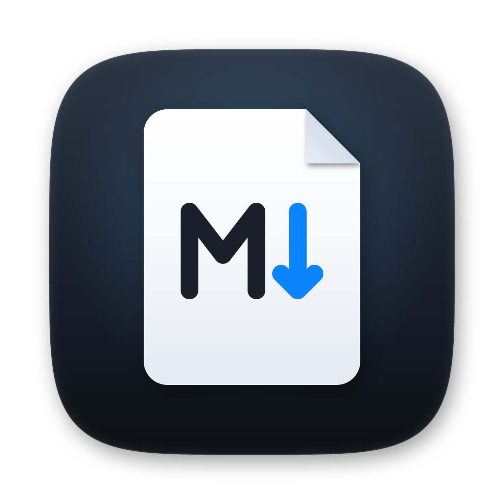

<p align="center"></p>

# MD-Viewer

**Native Markdown editor & viewer for macOS on Apple Silicon.**

---

> [!TIP]
> This is `start-up.md`. Make it yours — or delete it and MD-Viewer starts
> with an empty document.

## Get started

| Action | Shortcut |
| :--- | :--- |
| Open a file | ⌘O |
| Save / Save as | ⌘S / ⌘⇧S |
| Edit + live preview | ⌘P |
| Export PDF | ⌘E |
| Zoom | ⌘+ / ⌘− / ⌘0 |

Drag a `.md` file onto the window, or double-click one in Finder.

## What's inside

- **CommonMark + GFM** — tables, task lists, footnotes and highlighted code.
- **Obsidian & Pandoc** — callouts, wiki-links, embeds, front matter and `[TOC]`.
- **Math & diagrams** — LaTeX typeset in place; Mermaid flowcharts and more.
- **Safe HTML** — `<details>`, tables with spans, images and inline formatting.
- **Tabs, split view, click-to-source**, picture viewer, dark & Paper themes.

## A taste of Markdown

```rust
fn main() {
    println!("Hello, Markdown!");
}
```

Inline math: $E = mc^2$. A footnote[^1].

[^1]: Footnotes are typeset at the end of the document.

---

Project page: [github.com/JoergKau](https://github.com/JoergKau)
